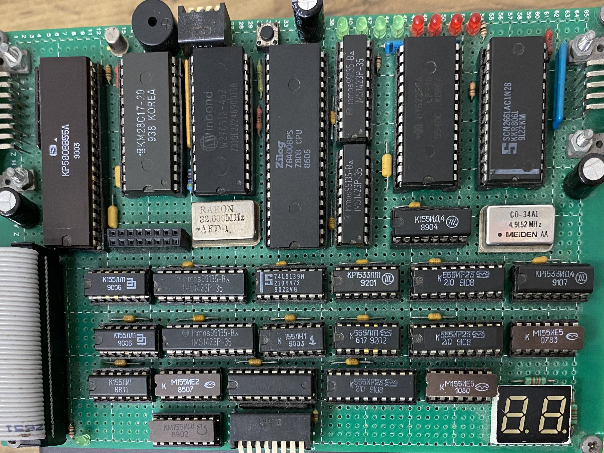
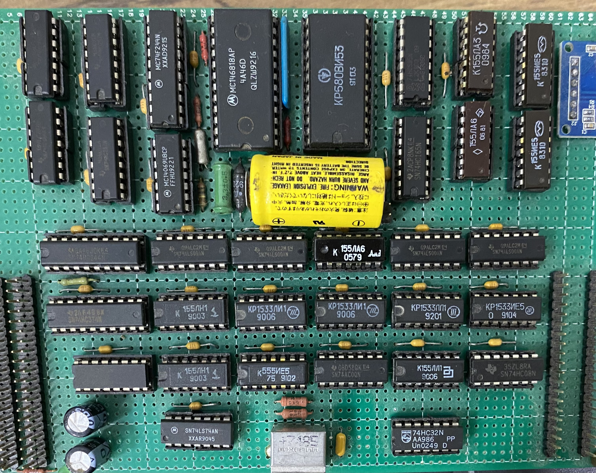

# Z80 Emulator

A Z80 computer, built twice: as a hand-wired board (Z80, PPI, PIT, RTC, PS/2 keyboard, LCD, UART) and as an
emulator that models the same board, with an IDE around it. You write Z80 assembly (or C-like code for the
bundled compiler), assemble it, and run it on the emulated board while watching the CPU, memory, interrupts
and peripherals live. The firmware is the same code that runs on the real board.

Built with [olcPixelGameEngine](https://github.com/OneLoneCoder/olcPixelGameEngine) (UI), Lua 5.4 (configuration)
and C++17.




## Features

- **Emulator window**: Z80 registers, ROM and RAM views, interrupt controller state, keyboard, PPI, PIT,
  RTC, LCD, LEDs, switches and a hex display, each as a movable panel.
- **Vim-style editor** with go-to-definition, macros, and breakpoints you can toggle while the CPU runs.
- **Custom assembler** (one pass over a label table) and a **disassembler** that follows the program counter.
- **CPU on its own thread** with a configurable clock (`CLOCK` in `config.lua`, `0` = as fast as possible).
- **Device bus**: each chip is a `Device` with `Read` / `Write`; the bus decodes memory and I/O addresses
  like the board does (see below).
- **Schematic window**: the board schematic is drawn inside the emulator. Wires light up with live signals
  and parts can be dragged.
- **Menus** (`Shift+?`) in the file tree and schematic windows.
- **zazy**: a small C compiler that emits code in this project's assembler dialect.
- **Test harness** for the assembly libraries (pytest + a Python model of the board).

## The board

|          |                                                                              |
| -------- | ---------------------------------------------------------------------------- |
| CPU      | Zilog Z80, 4 MHz (32 MHz oscillator through a divide-by-8 counter)           |
| ROM      | W27C512, 64 KB, bank selected by PPI port B bits 0-1; visible at `0000-3FFF` |
| SRAM     | IMS1423 at `4000-5FFF`; HY62256A (32 KB) at `8000`                           |
| RTC      | MC146818 at `6000` (own crystal, wait-state logic on the board)              |
| EEPROM   | KM28C17 at `C000` (not emulated yet, reads as 0)                             |
| PPI      | KR580VV55A (8255)                                                            |
| PIT      | KR580VI53 (8253), clocked at 500 kHz (CLK / 8)                               |
| UART     | SCN2661 with a 4.9152 MHz baud clock (emulation is a TODO)                   |
| Keyboard | PS/2, scan code set 2                                                        |
| Other    | character LCD, 7-segment display, LEDs, switches, buzzer                     |

### Address map

Memory, decoded by `D11` (A15:A14, then A13:A12 inside `4000-7FFF`):

| range       | select        | device            |
| ----------- | ------------- | ----------------- |
| `0000-3FFF` | MEM0          | ROM               |
| `4000-5FFF` | MEM10 / MEM11 | SRAM              |
| `6000-6FFF` | MEM12         | RTC               |
| `7000-7FFF` | MEM13         | unmapped          |
| `8000-BFFF` | MEM2          | SRAM (`RAM_ADDR`) |
| `C000-FFFF` | MEM3          | EEPROM            |

I/O ports, decoded by `D9` / `D10` (A4..A7):

| port        | device                                                    |
| ----------- | --------------------------------------------------------- |
| `0x10`      | hex display                                               |
| `0x20-0x23` | PPI                                                       |
| `0x30`      | UART                                                      |
| `0x40`      | keyboard (reading it acknowledges the keyboard interrupt) |
| `0x50`      | interrupt status (read) / interrupt mask (write)          |
| `0x80-0x83` | PIT                                                       |

PPI port C is the board's control bus: `C0`/`C1` gate the PIT counters (`C1` gates **both** timers),
`C2`/`C3` are RTC strobes and `C4..C6` select one of seven peripherals through a decoder (`C4` alone enables
the LCD).

### Interrupts

The firmware runs in **IM 1**: every interrupt jumps to `RST 38h`, which reads the status port (`0x50`) and
dispatches. Eight sources, each with a mask bit:

| bit  | source        | mask   |
| ---- | ------------- | ------ |
| 7    | PS/2 keyboard | `0x80` |
| 6    | UART RxRDY    | `0x40` |
| 5    | UART TxRDY    | `0x20` |
| 4    | RTC           | `0x10` |
| 3    | PIT counter 1 | `0x08` |
| 2    | PIT counter 2 | `0x04` |
| 1, 0 | not used yet  |        |

Each source has its own SR latch on the board. The mask gates the request **before** the latch, so a masked
source is never latched. The status port and the INT line are not gated. The latch is cleared by an
acknowledge strobe: reading the keyboard port for bit 7, and any access to `0x80-0x8F` for bits 3 and 2
(both timers at once). Handlers must preserve `B` and `C`.

## Repository layout

```
assets/
  lib/         assembly libraries: Init, EventLoop, Timer, Keyboard, Lcd, RTC, Hex, Printf,
               Buffer, FileSystem, Command, Utils, ASCII, Defs, utils/{Math,String,Message,Adapter}
  src/DoS/     the DoS demo shell (Main.z80)
  test/        hardware test programs: LCD, Timer, RTC, UART
  blueprint/   reference listings
  img/         screenshots
src/Bus/       emulated devices: Bus, Cpu, IRQ, PIT, PPI, RTC, Keyboard, Lcd, Led, Switch, Hex, Memory
```

## Assembly dialect

- Labels: `@PUBLIC:` (exported), `_FUNCTION:`, `.LOCAL:` (scoped to the enclosing label).
- Relative jumps need an explicit offset: `JR NZ, label-$`. Without `-$` the operand is used as a raw displacement.
- `INCLUDE`, `MACRO` / `ENDM`, `EQU`.
- `RST 0x10` prints a character on the LCD.

## Firmware

| file                            | purpose                                                                 |
| ------------------------------- | ----------------------------------------------------------------------- |
| `Init.z80`                      | reset, IM 1 setup, `RST 38h` dispatcher, stack at `5FFF`                |
| `EventLoop.z80`                 | priority queue of tasks (`0x4400`, up to 85) and the timer task buffers |
| `Timer.z80`                     | timer tasks on PIT counters 1 and 2 (period, repeat count, handler)     |
| `Keyboard.z80`                  | PS/2 set 2 state machine, caps lock, ctrl-c                             |
| `Lcd.z80`, `Hex.z80`            | LCD and 7-segment output                                                |
| `RTC.z80`                       | MC146818 read, set time, alarm                                          |
| `Printf.z80`, `Buffer.z80`      | formatted output and the input buffer                                   |
| `FileSystem.z80`, `Command.z80` | tiny file system and the command interpreter                            |

The interrupt lock (`_INTR_LOCK` / `_INTR_UNLOCK`) is a nesting counter: `DI` on the first lock, `EI` when
the count returns to zero.

## Configuration (`config.lua`)

```lua
WIDTH = 840; HEIGHT = 514; PIXELS = 1
CLOCK  = 0                                  -- 0 = full speed, otherwise nanoseconds per clock
SOURCE = "assets/src/DoS/Main.z80"          -- program to load

PANELS = { {                                -- one table per layout: window name = { x, y, width, height }
  filesystem = { x = 0, y = 0, width = 140, height = HEIGHT - 35 },
  editor     = { x = WIDTH - 700, y = 0, width = 490, height = HEIGHT - 35, selected = true },
  schematic  = { x = 0, y = 0, width = WIDTH, height = HEIGHT - 35 },
} }

-- schematic (see assets/schematic.lua)
SCHEMATIC = { ... }          -- or dofile("assets/schematic.lua")
SCHEMATIC_LAYOUT = { D54 = { x = 80, y = 30 } }   -- positions of dragged parts
```

## Schematic window

| input                         | action                                           |
| ----------------------------- | ------------------------------------------------ |
| mouse wheel                   | zoom                                             |
| right / middle drag           | pan                                              |
| left drag on a part           | move it (edit mode)                              |
| click a wire                  | keep it highlighted                              |
| `H J K L`, `=` `-`, `0` / `F` | pan, zoom, fit                                   |
| `E`                           | edit mode on / off                               |
| `R`                           | reload from Lua                                  |
| `Shift+?`                     | menu: print moved parts / all parts, reset, snap |

The schematic file builds `SCHEMATIC` with a few helpers (`chip`, `gate`, `tag`, `wire`). Net names are the
signal names from the drawing, and the same names are used to bind live values in C++:

```cpp
sch->BindBit("INT7", [] { return Registry::IRQ->Read(0, true); }, 7, /*activeLow=*/true);
sch->Strobe("IO8");      // once, on the UI thread
sch->Hit("IO8");         // from the bus, on any thread: lights the wire for ~30 frames
```

## zazy: a C compiler for this board

`zazy` reads a small C subset and writes a `.z80` file in this assembler's dialect. The output uses the
project's own conventions (register use, `RST 0x10` for characters, `@MUL16x8`, `@DIV8`) and links against
`Init.z80`. `void setup()` becomes `SETUP` and `void main()` becomes `MAIN` (the event loop calls it repeatedly).

```
make                                     # builds ./zazy and tools/z80run (a headless Z80 used by the tests)
./zazy -o hello.z80 hello.zz
./zazy --bare -o t.z80 t.zz              # own reset code, output on port 0x00 (for tests)
```

Supported: integer types, structs, arrays, `__at(addr)` globals, inline `asm{}`, `naked` functions and
`extern ... asm("@LABEL", in(), out(), clobber())` bindings to the firmware. Not supported: function pointers,
`volatile`, more than three register parameters.

## Testing

The assembly libraries run on a Python model of the board (random RAM, interrupt injection, register and
stack checks) after a translation to sjasmplus.

```
pip install pytest z80
SJASMPLUS=/path/to/sjasmplus ./run.sh          # z80-lib-tests/
```

The board model has three bus modes: `hardware` (how the schematic behaves, default), `emulator` (the current
`Bus.cpp`) and `legacy` (the first `Bus.h`), so the same firmware test shows where the emulator and the board
differ. The zazy compiler has its own tests in `zazy/tests`.

## Known limitations

- The UART is not emulated (`0x30`) and neither is the EEPROM at `C000`.
- `PIT.h` quirks: output starts high, so the first gated tick raises a request, and a counter that was never
  loaded fires on every tick.
- The emulator latches an interrupt request even when it is masked and acknowledges only `0x81` / `0x82`;
  the board masks first and acknowledges on any access to `0x80-0x8F`.
- The real PS/2 receiver holds one byte; the emulator's keyboard has a lossless FIFO.
- The RTC wait-state logic and some parts of the PS/2 receiver are only sketched in the schematic.

## Build

Needs a C++17 compiler, olcPixelGameEngine, and Lua 5.4 static libraries in `lua54/{win32,linux,emsc}`
(the browser build uses Emscripten).

<!-- TODO: add the exact build command for the emulator here (cmake / make / emcc). -->
